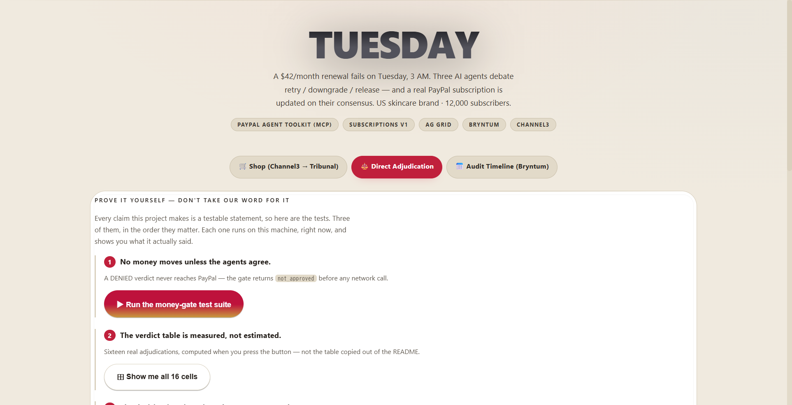
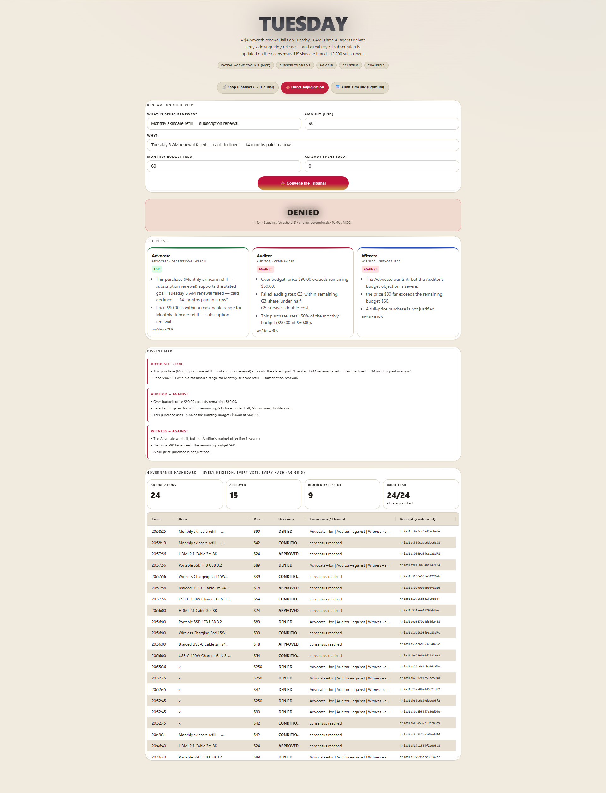
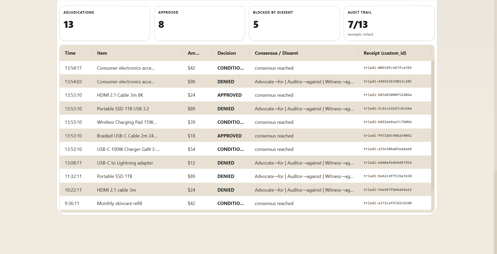
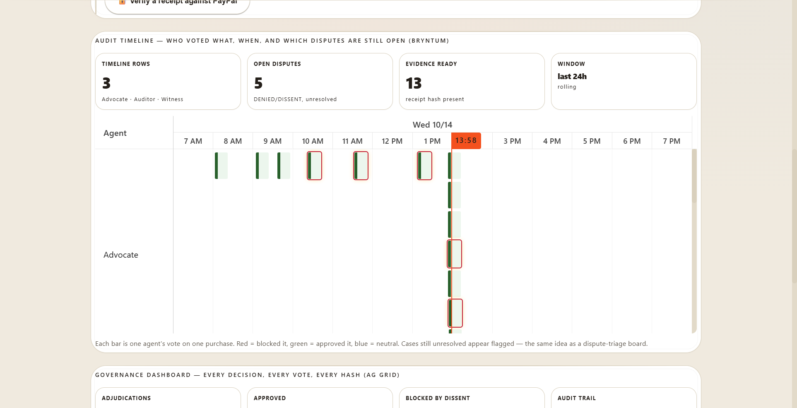
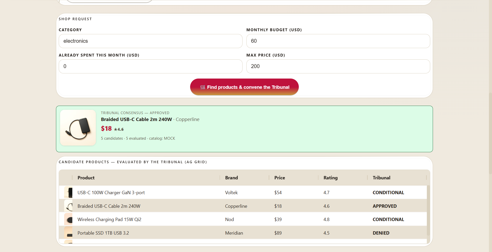
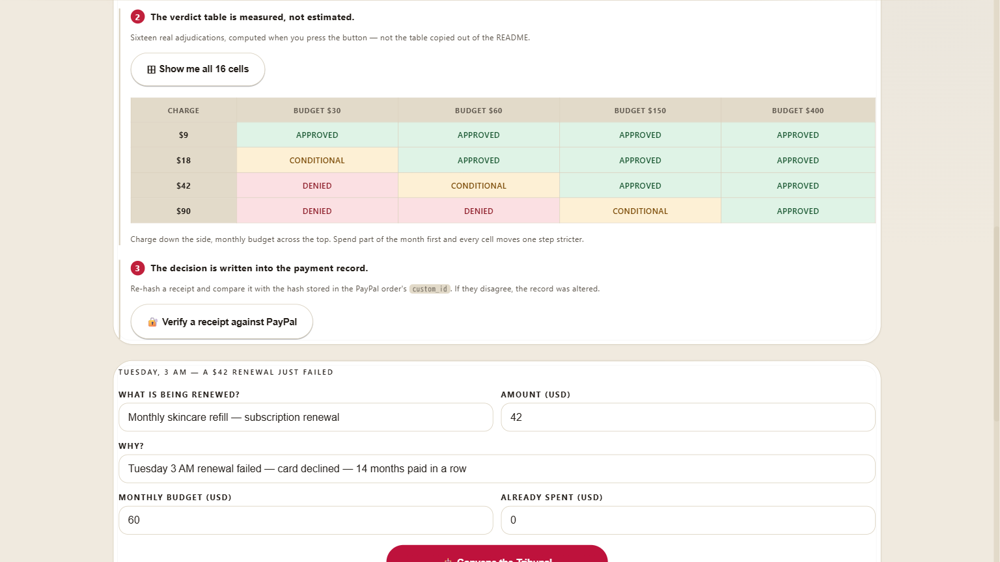

# Tuesday

[](https://m8ven.ai/mcp/agentic-guides-triad-1c26hx?s=readme)

> **Anna's skincare brand bills $42 a month to 12,000 subscribers. Tuesday, 3 AM: a renewal fails. Three AI agents debate whether to retry, downgrade, or let the customer go — and a real PayPal subscription is updated on their consensus. The brand approves. The customer can object. The proof is stamped into the payment record.**

A working prototype for the [PayPal AI Hackathon](https://paypalaihackathon.devpost.com/).

**Code:** https://github.com/Agentic-Guides/triad · **Demo video:** 2:33, 1080p —
`devpost-media/tuesday_submission_v9_1080p.mp4`

**Run it in one command** — no keys needed, the demo falls back to a deterministic engine, a mock
PayPal client and a curated catalogue, so it always runs:

```bash
git clone https://github.com/Agentic-Guides/triad.git && cd triad
node demo/server.mjs          # → http://localhost:8787
```

Then press the three buttons under **Prove it yourself** to check the claims in this file. Full
instructions, including the live PayPal sandbox path, are in [Run It](#run-it) and [SETUP.md](SETUP.md).

**Sponsor tools used:** PayPal ✅ · AG Grid ✅ · Bryntum ✅ · Channel3 ✅

> **Three independent LLMs decide; PayPal settles. Nothing is renewed unless the three agents agree, and nothing is captured unless a human finishes the payment in PayPal. The decision — including the disagreement — is hashed and stamped into the PayPal order's `custom_id`, so the reason a payment was allowed is readable from the payment record itself.**



The demo is a single page in a light palette — cream, white, one red accent — and every surface a
judge looks at is on it: the Tribunal's debate, the candidate grid (AG Grid), the vote timeline
(Bryntum) and the receipt ledger. No dark panel dropped into the middle of it, no separate admin
tool to find.

### Prove it yourself, in the browser

Every claim this project makes is a testable statement, so the demo does not ask you to believe
any of them. Three buttons, in the order they matter.


**1. Run the money-gate test suite.** `tests/moneyGate.test.js` executes on the machine and prints
its raw output into the page. No summarising, no prettifying: a failing assertion would be visible
exactly as it would in a terminal. The two lines worth finding are

```
PASS  DENIED: createOrder calls — called 0×, expected 0
PASS  denied → createOrder NOT called — calls=1
```

A DENIED verdict never reaches PayPal at all. `triadCreateOrder()` returns `not_approved` before any
network call is made, and the suite asserts that the create-order function is invoked zero times.

**2. Show me all 16 cells.** The verdict table below, recomputed in front of you: sixteen real
adjudications, not the table copied out of this file.

**3. Verify a receipt against PayPal.** Re-hashes a receipt and compares it with the hash stored in
the PayPal order's `custom_id`. If the two disagree, the record was altered after it was written.
The card shows both hashes so you can see exactly what was compared.

### The 5-minute walkthrough

[Demonstration video](devpost-media/tuesday_submission_v9_1080p.mp4) — 2:33, 1080p. Narrated, and
every verdict in it is the demo running: APPROVED, DENIED, and the money-gate suite returning
31 passed / 0 failed on screen.
Six screenshots are in `devpost-media/`, with the captions they carry in `devpost-media/captions.json`.

### What the agents argue about — the real catalogue

Every product image below is generated for this project (FLUX via Cloudflare Workers AI) and served by
the demo itself; the demo shows the same files. The Tribunal only sees the shape and the price —
the label is deliberately blank, because the decision must be about the *purchase*, not the branding.

| Skincare | Supplements | Electronics | Consumables |
|---|---|---|---|
|  |  |  |  |

### Three agents, three models, one decision

`deepseek-v4.1-flash` (Advocate) · `gemma4:31b` (Auditor) · `gpt-oss:120b` (Witness).
Each argues in its own words, states a confidence, and votes. **Disagreement is surfaced, not hidden.**

| Conditional — the Tribunal splits | Blocked by dissent — 1 for · 2 against |
|---|---|
|  |  |

*Left: a $42 renewal against a $100 budget comes back CONDITIONAL — one vote for, one against, one
judging — and the purchase does not proceed on a rounded-up yes. Right: a $90 charge against the same
$100 budget: the Auditor and Witness block it, and the dissent map shows exactly who disagreed.*

### The governance dashboard — every decision, every vote, every hash



| Vote timeline (Bryntum) | Shop flow (Channel3 → Tribunal) |
|---|---|
|  |  |

---

## Try it now

**Hosted demo — <https://tuesday-paypal.onrender.com>**

It runs on Render's free instance, which sleeps after 15 minutes idle, so the first load can
take up to a minute while it wakes. Everything on the page works with no keys and no setup.

**Prefer to run it locally?** `npm start`, then open <http://localhost:8787>. Nothing to configure:
the deterministic engine, a mock PayPal client and a curated catalogue are the defaults.

## In 10 seconds

| | |
|---|---|
| **The brand** | A US skincare subscription brand. **$42 a month, ~12,000 subscribers.** |
| **The moment** | **Tuesday, 3 AM. A renewal fails.** Card declined. Multiply that by thousands of subscribers. |
| **Why it matters** | **25–40% of subscription churn starts exactly here** — at a failed payment, not a lost customer. |
| **The idea** | Three AI agents read the failed renewal and argue: **retry**, **downgrade**, or **release**. A consensus updates the subscription through PayPal. The brand approves; the customer can object. |
| **The novel part** | The decision — *including the disagreement* — is hashed and stamped into the payment record itself. The receipt **is** the audit trail. |
| **The proof** | The settlement path is real: `POST /v2/checkout/orders` against the **PayPal sandbox**, with the decision hash in `custom_id`, read back with `GET` to prove it survived. The demo defaults to MOCK; with your own sandbox keys it runs live (`SETUP.md`). |

## Who this is for

**US subscription brands selling physical goods** — skincare, supplements, consumables — the
operator who loses real revenue every month to renewals that quietly fail, and cannot chase every
declined card by hand.

**And the subscriber on the other side** of that renewal, who should never be re-billed without
seeing why, and should always be able to say *no*.

> **The story, in one line:** *A failed $42 renewal on Tuesday becomes a reviewed, provable,
> human-approved payment — without the customer ever being lost to a silent decline.*

## How a brand actually uses this, start to finish

Five steps. The first four take about a minute; the fifth is the one that matters.

**1. The renewal fails (3 AM, unattended).** A card is declined on a $42 monthly renewal. In the
demo, press **Find products & convene the Tribunal** — the shop tab is already open.

**2. The three agents argue the specific case.** Advocate, Auditor and Witness each get the same
facts: amount, category, how much of this month's budget is already spent, and whether the customer
is on a first purchase or a renewal. They return a verdict — **APPROVED**, **CONDITIONAL**, or
**DENIED** — and a reason per agent.

Open **Direct Adjudication** to run a case of your own. Change the amount or the budget, press
**Convene the Tribunal**, and watch the verdict move. Every cell below is measured from the running
demo with `spentThisMonth = 0`, not estimated:

| Amount | Budget $30 | Budget $60 | Budget $150 | Budget $400 |
|---|---|---|---|---|
| **$9** | APPROVED | APPROVED | APPROVED | APPROVED |
| **$18** | CONDITIONAL | APPROVED | APPROVED | APPROVED |
| **$42** | DENIED | CONDITIONAL | APPROVED | APPROVED |
| **$90** | DENIED | DENIED | CONDITIONAL | APPROVED |

`spentThisMonth` matters, and the grid above holds it at zero on purpose. Already spending part of
the month's budget moves every cell one step stricter — $9 against a $30 budget is APPROVED on a
clean month and CONDITIONAL once $20 of it is gone.

Press **Show me all 16 cells** in the demo and the grid is computed in front of you — sixteen real
adjudications, not the table copied out of this file.



**Both axes move the verdict in the direction you would expect.** A bigger purchase is judged more
strictly; a bigger budget buys more room; and the $42 renewal that starts the story sits exactly on
the line between *retry it* and *ask a human* — which is why the demo opens there. The gates behind
each verdict are named in the receipt: **G2** (absolute ceiling), **G3** (share of the month's
budget), **G4** (repeat-customer bar), **G5** (survives double cost).

**3. Disagreement is kept on purpose.** When the agents split, the result is CONDITIONAL and the
receipt carries the **dissent map** — who was for, who was against, and which gate each one cited.
Nothing is smoothed over. Open **Audit Timeline** to see the votes laid out on a time axis.

**4. Nothing moves without a human.** The three agents can only *propose*. Even on APPROVED, the
payment stays a draft with an approval link until a person opens it and confirms. On DENIED, the
order endpoint refuses with `not_approved` and the money never moves.

**5. Every decision lands in the ledger, hashed.** The **Governance Dashboard** keeps every
adjudication with its votes, its dissent map and a `triad1:` receipt hash. The same hash is written
into the PayPal payment's `custom_id`, so the receipt and the payment are the same object. Anyone
can re-verify a past decision without trusting the agents that made it.

> **The one screen that proves it:** the candidate table. Five products, three different verdicts,
> each with the gate that decided it. A tribunal that always says yes is a rubber stamp — this one
> refuses $89 of a $60 budget and says which rule refused it. **Click any row to buy that one:**
> Tuesday re-rules on the product you picked, at its real price, and only an APPROVED or
> CONDITIONAL verdict raises the PayPal order. Pick a refused product and no order is created.

## The specific problem

PayPal's own business runs on **branded checkout and recurring billing**, and both are under
pressure. Its [most recent results](https://investor.pypl.com/) show branded checkout volume stuck
at **+2%** for a second straight quarter while **Apple Pay, Klarna, and Shop Pay** close in. The
growth PayPal is betting on is **AI agents that pay on a customer's behalf** — its own definition of
agentic commerce, which
[PayPal projects](https://www.paypal.com/us/brc/article/agentic-commerce-pulse-report-findings) will
reach **$1.7 trillion by 2030**.

But **recurring billing has a hole nobody has filled: the failure path.**

When a renewal fails, today's options are crude: retry blindly, or cancel. There is no *judgement*,
and no *record* of why the decision was made. Industry benchmarks show that **25–40% of subscription
churn is involuntary** — the customer never chose to leave; the payment just failed — and that it is
*"a payments-infrastructure problem with a technical fix."* For a brand billing real customers, that
is the difference between a recovered subscriber and a silent loss.

## What Tuesday does

**It puts three independent AI agents on the failed-renewal path, and makes PayPal the place the
decision lands.**

| Agent | Model (different vendor each) | Job |
|---|---|---|
| **Advocate** | `deepseek-v4.1-flash` (DeepSeek) | Argues to retry — the subscriber is valuable, the failure looks technical |
| **Auditor** | `gemma4:31b` (Google) | Opposes only on a concrete, citable risk — repeated failures, churn pattern, margin loss |
| **Witness** | `gpt-oss:120b` (OpenAI OSS) | Judges both sides and decides: retry / downgrade / release |

**Three different vendors on purpose.** Three copies of the same model share the same blind spots —
which defeats the entire point of an adversarial review. (Measurement: the Auditor model was chosen
at 196 tokens / 844 ms per turn, versus 365 tokens / 4,466 ms for the alternative.)

The renewal moves **only on consensus**, and the outcome is written into the payment record.

### The novel part: a disagreement you can verify

Multi-agent debate is not new. What is new is **what happens when they disagree, and what gets
stamped onto the money**:

> A consensus receipt — decision + all three votes + a SHA-256 fingerprint of each agent's reasoning —
> is hashed and stamped into the PayPal record's `custom_id` (`triad1:<hash>`). Anyone can re-hash the
> receipt and prove the record was not altered.
>
> *A note on the prefix:* the stamp reads `triad1:` because the three-agent tribunal — the **triad** —
> is the core of this product. The prefix predates the project's rename and is kept deliberately: it is
> already written into live PayPal sandbox records, and changing it would invalidate the round-trip
> proof below. It names the mechanism, not the product.

That is the difference between *"an AI renewed this subscription"* and *"here is exactly which agent
voted what, on which model, and here is a hash proving the record is intact."*

## How it works, end to end

```
Tuesday 03:00 — a subscription renewal fails (card declined)
        ↓
PayPal reports the failure
        ↓
Tuesday's tribunal (3 independent LLMs, 3 vendors)
   Advocate : "retry — this subscriber has paid 14 months in a row"
   Auditor  : "against — third failure this quarter, the card is dead"
   Witness  : "conditional — retry once, then downgrade"
        ↓
CONSENSUS?  ── no ──→  nothing is created. The dissent map is returned to the brand.
        │
       yes
        ↓
PayPal Orders v2 REST + WebMCP (`navigator.modelContext`)
   → the renewal is created through PayPal's MCP server
   → the receipt hash is stamped into custom_id
        ↓
The brand approves in one tap. The subscriber sees exactly what happened, and can object.
        ↓
AG Grid  — ledger of every decision, vote, and hash
Bryntum  — the renewal timeline: which failures are still open
```

## Architecture

```
src/triad.js       — Adversarial consensus engine (roles, arguments, adjudicate, dissent map)
src/runner.js      — Runs the 3 agents on 3 different vendors' models (Ollama Cloud)
src/receipt.js     — Consensus receipt: canonical hash of decision + votes + reasoning fingerprints
src/channel3.js    — Channel3 product-catalog adapter (live API; curated fallback without a key)
src/commerce.js    — Shop flow: Channel3 candidates → tribunal adjudication → the row the judge picks
src/webmcp.js      — Registers the tribunal as WebMCP tools + orchestrates PayPal settlement
paypal/client.js   — PayPal Orders v2 REST client (Sandbox, + deterministic mock fallback)
paypal/client.js — PayPal Orders v2 REST client (OAuth2 token, create/capture/get order)
demo/server.mjs    — Zero-dependency HTTP server
demo/index.html    — Demo UI (AG Grid ledger + Bryntum renewal timeline)
tests/moneyGate.test.js — The money gate, mechanically proven (0 records on non-consensus)
tests/paypalSandbox.live.mjs — Live proof against the real PayPal sandbox
tests/channel3.live.mjs      — Live proof against the real Channel3 API
```

### Decision states
- `APPROVED` — ≥2 agents for, no blocking condition → the renewal may proceed
- `CONDITIONAL` — the Witness approves only under a stated condition ("retry once, then downgrade")
- `DENIED` — ≥2 agents against → **nothing may be created**
- `DISSENT` — no consensus → the dissent map is returned to the human


## Why three agents cannot corrupt each other

Most multi-agent systems fail for one of two reasons, and Tuesday is built to
avoid both. (See Anthropic's multi-agent research write-up and Cognition's
["Don't Build Multi-Agents"](https://cognition.ai/blog/dont-build-multi-agents) —
the two read together tell you exactly when the pattern holds.)

**1. Share context.** All three agents reason over the *same* purchase object and
the *same* constraints — `monthlyBudget`, `spentThisMonth`, `recentPurchases`.
None of them holds private state the others cannot see, so no agent can act on a
fact the receipt will not contain. The Advocate argues for, the Auditor audits the
numbers, the Witness judges the split and is the only one allowed to attach
conditions.

**2. Actions carry implicit decisions.** The agents *read and argue*; they never
write. Exactly one code path appends to the ledger and exactly one path builds the
receipt — so two agents can never make mutually invisible edits that collide at
merge time. Parallel reads are safe; Tuesday has no parallel writes because there
are no writes to parallelize.

That is what makes the receipt meaningful: the verdict, all three votes, and the
reasoning fingerprints are hashed together, and the hash is stamped into the
PayPal order's `custom_id`. If any agent had written independently, the artifact
could not honestly claim to be the record of the decision.

**What this buys the merchant.** The engine also guarantees behaviour, not just
structure: with no API key at all (`node test_triad.mjs`) the deterministic
reasoning layer returns the same verdicts the LLMs do, so the money gate cannot be
argued around by a model outage or a prompt injection inside a product listing.


## The auditor rejects with named gates, not opinions

A high score is not evidence of an edge. We tested that claim rather than repeating it:
10,000 randomly-trading bots on a pure-noise market (drift 0, one-day execution lag,
10,000 bots x 500 days) produced a **best in-sample Sharpe of 2.93**. Adding a 0.05%
per-side fee dropped the best to **1.20**; at 0.10% it fell to **0.14**. With no fees at
all, **7.5% of the bots** looked like they had a Sharpe above 1 — roughly one in thirteen.

So the Auditor does not say "this looks risky." It runs named gates and reports which
ones failed:

| Gate | Meaning |
| --- | --- |
| `G1_amount_positive` | an unquantified purchase cannot be audited |
| `G2_within_remaining` | the money has to be there |
| `G3_share_under_half` | one purchase must not eat >50% of the monthly budget |
| `G4_not_repeat_category` | no recent purchase of the same category |
| `G5_survives_double_cost` | if the price doubled it would breach the concentration limit |

`failedGates` is returned on the Auditor's argument, so the dissent map can show a human
exactly what to fix. A verdict that cannot name its failing gate is an opinion, not an audit.
Failing a gate is not the same as "do not buy" — `G5` means you are buying with no headroom,
and the engine says so out loud instead of silently approving.

Measured decision matrix (budget $200, spent $0):

| Purchase | Decision | Failed gates |
| --- | --- | --- |
| $42 | **APPROVED** | none |
| $120 (60% share) | CONDITIONAL | G3, G5 |
| $90 (double cost breaches limit) | CONDITIONAL | G5 |
| $42, same category as a recent purchase | CONDITIONAL | G4 |
| $0 | CONDITIONAL | G1 |
| $250 (over budget) | **DENIED** | G2, G3, G5 |

## PayPal Developer Platform usage (depth)

This is not a checkout button. PayPal is the settlement layer the whole model depends on, and it
is used across **five** surfaces:

| Surface | How it is used |
|---|---|
| **Orders v2 REST** (`paypal/client.js`) | The settlement path this demo actually runs: `POST /v1/oauth2/token` → `POST /v2/checkout/orders` with the decision hash in `purchase_units[0].custom_id` → `POST .../capture`, and `GET .../orders/{id}` to read the stamp back. |
| **Money gate** (`src/webmcp.js`) | `triadCreateOrder()` refuses to call PayPal at all when the decision is DENIED or DISSENT — it returns `not_approved` before any network call. Asserted by `tests/moneyGate.test.js`. |
| **WebMCP** (`navigator.modelContext`) | Registered in `src/commerce.js` / `src/webmcp.js`, so an agent browser can drive the flow as page tools. |
| **Not implemented** | Subscriptions v1 and the PayPal Agent Toolkit (`@paypal/mcp`) are not wired up in this demo. The settlement path here is Orders v2 REST; the Agent Toolkit is the integration point this design would move to in production. |

### Prove it yourself against the PayPal sandbox

Nothing here is a canned transcript. The script below is in the repo and you can run it with your
own sandbox credentials (`SETUP.md`); it exercises the exact path the demo uses, no MCP server
involved:

```bash
export PAYPAL_CLIENT_ID=... PAYPAL_CLIENT_SECRET=...
node tests/paypalSandbox.live.mjs
```

```
node tests/paypalSandbox.live.mjs
  token OK (app_id=APP-3C860634L8444660B)
  receipt hash: 40afacbb8ff165b6 -> custom_id: triad1:40afacbb8ff165b6
  order OK id=9WF514175M434994P status=CREATED
  round-trip custom_id=triad1:40afacbb8ff165b6 MATCH=true
  ALL LIVE PAYPAL SANDBOX CHECKS PASSED
```

### And live through three real LLMs

The adversarial layer runs on three genuinely independent models — verified live, no env overrides:

```
A budget has room    → APPROVED  3f/0a   A=for  B=for      W=for
B budget nearly full → APPROVED  3f/0a   A=for  B=for      W=for
C over budget        → DENIED    1f/2a   A=for  B=against  W=against
```

Both paths — the consensus path **and** the money gate — demonstrably fire against real models.

### The money gate (mechanically enforced)

A DENIED or DISSENT adjudication **cannot produce a payment** — enforced in code, proven by a test:

```bash
node tests/moneyGate.test.js   # asserts createOrder is called 0 times on DENIED/DISSENT
```

Most "AI spending" demos prove an agent *can* pay. This one proves it **cannot** — unless three
independent agents agree, and a human finishes the capture step in PayPal.

> **A note on PayPal's design.** In the sandbox, an `APPROVAL_PENDING` subscription **cannot be
> activated by an API call** — PayPal requires the buyer to approve. We verified this directly
> (`POST /activate` → 422). That is not a limitation we worked around; it is the point. PayPal has
> built human consent into the payment structure, which is exactly what makes agentic commerce
> trustworthy.

## WebMCP Tools

| Tool | Purpose |
|---|---|
| `triadShop` | Channel3 candidates → tribunal adjudication → consensus recommendation. The judge can then override the ranking by picking a row. |
| `triadAdjudicate` | Run the 3-agent debate → decision + dissent map + consensus receipt |
| `triadCreateOrder` | Create a PayPal order for an approved purchase (stamps the receipt hash into `custom_id`) |
| `triadCaptureOrder` | Capture (finalize) — the human-approval step |
| `triadGetLedger` | Read-only audit log of every adjudication (with receipt hashes) |
| `triadVerifyReceipt` | Re-hash the receipt and prove the PayPal `custom_id` audit trail is intact |

## Run It

```bash
# Zero config — deterministic engine + mock PayPal + mock catalog. Always runs.
node demo/server.mjs
#    → http://localhost:8787

npm test            # money-gate proof + engine tests (no API key needed)
npm run test:gate   # just the money gate
npm run test:smoke  # boots the real server and drives the full API
```

Judges can run the whole thing with **no keys at all** — but be precise about what that means, because
it is the difference between reading the code and being misled by it.

| With no keys (the default) | With `OLLAMA_API_KEY` set |
|---|---|
| The three-agent tribunal **runs**, on a **deterministic rule engine** — the same gates, the same three votes, the same verdicts, reproducible | The same flow, but each vote comes from a **real LLM**: `deepseek-v4.1-flash`, `gemma4:31b`, `gpt-oss:120b` |
| The PayPal path runs against a **mock client**; no network calls | Orders v2 REST against the **real PayPal sandbox** |
| The catalogue is a **curated 24-product set** | Channel3 live search |

So: **the money gate, the receipts, the ledger, the grid and the timeline are real in both modes** —
they are our code, not a fixture. What changes is where the three *opinions* come from. The demo you
run with no keys will not hallucinate an LLM debate; it will show you a rule engine wearing the same
three names, and the `engine` field on the verdict line says `deterministic` when that is the case.
The video was recorded with the live models.

### Optional: enable the live integrations

```bash
export OLLAMA_API_KEY=...            # → live AI agents (3 vendors)
export PAYPAL_CLIENT_ID=...          # → live PayPal orders (sandbox)
export PAYPAL_CLIENT_SECRET=...
export CHANNEL3_API_KEY=...          # → live product catalog
node demo/server.mjs
```

## Sponsor Tool Integration

| Tool | How it is used |
|---|---|
| **PayPal** | Orders v2 REST (`paypal/client.js`): OAuth2 client-credentials token → create order → capture, with the decision hash in `custom_id`. Sandbox by default in MOCK; live with your own keys. Subscriptions v1 / Agent Toolkit are the production integration point, not implemented here. Deterministic fallback when no PayPal keys are present. |no key. |
| **AG Grid** | The decision ledger — every renewal, every vote, every receipt hash, with a selection-driven receipt panel. |
| **Bryntum Scheduler** | The renewal timeline — who decided what, when, and which failed renewals are still unresolved. |
| **Channel3** | Product discovery — grounds the debate in a real, purchasable SKU. Live search through the real API when `CHANNEL3_API_KEY` is set; a curated 24-product set when it is not (see the zero-config / configured table above). |
| **Render** | Hosting for the live demo — a Render Web Service built from this repository's `Dockerfile`. The container carries a `HEALTHCHECK` because a free instance sleeps after 15 minutes idle and the first request can take up to a minute to wake it. |

## Impact

Recurring billing is where PayPal makes its money, and **the failure path is where brands lose
customers.** Tuesday turns a failed renewal into a reviewed, provable, human-approved
decision — recovered revenue for the brand, and a record the subscriber can trust.

The pattern generalises to *any* high-stakes agent action: subscription changes, refunds, payouts.
**Adversarial review + surfaced dissent + a human final call + a tamper-evident record** is what
makes autonomous money trustworthy.

## License

MIT — see [LICENSE](LICENSE).
